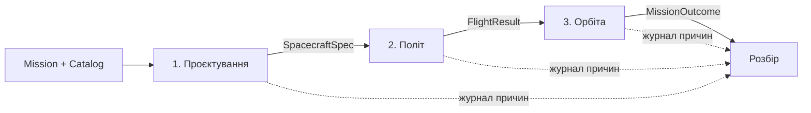
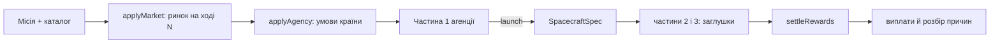

# Архітектура hryah

> Статус: чернетка від 14.11, ранок. Перші пів години кожен може правити. Після цього зміни в розділах 3–6 ідуть лише через інтеграторів.

Цей документ потрібен, щоб усі шестеро говорили однією мовою і могли писати код паралельно. Він відповідає на три питання: що куди класти, що кому віддавати, з чого почати.

## 1. Гра одним абзацом

Одна місія з трьох частин. Гравець **проєктує** апарат на Землі, **доставляє** його на орбіту і **керує** ним на орбіті. Рішення першої частини визначають, наскільки важкими будуть друга й третя. Наприкінці гра показує розбір: що пішло не так і яке саме рішення до цього привело. Один забіг має тривати до 10 хвилин, щоб гравець хотів зіграти ще раз.

| Частина | Що робить гравець | Спрощена версія (робимо першою) |
|---|---|---|
| 1. Проєктування | збирає апарат: двигун і паливо, енергія, зв'язок, прилад | три варіанти на слот, цифри рахуються наживо |
| 2. Політ | розв'язує задачі на пультах корабля | кліки по пультах, поки біжать таймери |
| 3. Орбіта | тумблерами тримає супутник живим під час подій | покроково, десять ходів |

Поверх трьох частин працює **консорціум агенцій** (розділ 12): кілька агенцій по черзі за одним екраном проєктують апарати для однієї місії, а нагорода залежить від цінності отриманих даних. Одна агенція це той самий забіг, що описаний вище.

## 2. Головна ідея

Дані течуть в один бік. Кожна частина отримує результат попередньої, додає свій і передає далі.



З цього випливають три правила, на яких тримається все інше:

1. **Частини не знають одна про одну.** Вони знають лише типи на стрілках. Тому три групи можуть працювати незалежно.
2. **Кожну частину можна замінити заглушкою.** Заглушка віддає той самий тип, що й справжня частина. Гра проходиться наскрізь із першого дня.
3. **Логіка живе в ядрі, а не в компонентах.** Ядро — це чисті функції над JSON-станом. React лише показує стан і надсилає дії.

Правила 3 вже вимагає CI (`REVIEW_RULES.md`, крок `core purity`).

## 3. Що де лежить

```
src/
  core/                    ЯДРО: без React, DOM, Math.random(), Date.now()
    contracts.ts           спільні типи між частинами        (інтегратори)
    physics.ts             формули без стану                 (інтегратори + фізика)
    model/                 апарат, паливо, орбіта, енергія: buildSpec та ін. (математика)
    stubs.ts               розрахунки заглушок і тестові дані (інтегратори)
    stub-phases.ts         заглушки у формі Phase            (інтегратори)
    phases.ts              яка частина справжня, яка заглушка (інтегратори)
    game.ts                склейка частин в одну гру         (інтегратори)
    sim.ts                 гра без екрана: перебір проєктів  (інтегратори)
    design/                логіка частини 1 і профіль агенції (група 1)
    consortium/            хід агенцій, ринок у часі, нагорода (група 1, розділ 12)
    flight/                логіка частини 2                  (група 2)
    orbit/                 логіка частини 3                  (група 3)
    debrief/               побудова ланцюжка причин          (інтегратори)
  data/                    ДАНІ: лише JSON
    catalog.json           модулі
    missions.json          місії та носії
    agencies.json          агенції (країни): бюджет, носії, ціни модулів
    market.json            коли модуль з'являється й як дешевшає
    texts.en.json          усі тексти за ключами
  ui/                      ЕКРАНИ: React, жодної ігрової логіки
    shared/                спільні компоненти (графік запасу, шкала, кнопки)
    design/  flight/  orbit/  debrief/
    design/                екран проєктування й екран консорціуму
    text.ts                t(ключ, параметри): тексти екранів із texts.en.json
    debug/                 дебаг-екран: гра кнопками без графіки
  App.tsx                  поки перемикає екрани за #design / #debug
```

Кожна група пише у двох своїх теках: `core/<частина>/` і `ui/<частина>/`. Чужі теки й спільні файли не чіпаємо без PR на інтеграторів.

## 4. Контракти

Джерело правди — `src/core/contracts.ts`. Тут лише огляд, поля дивіться у файлі: там кожне має коментар.

| Тип | Що це | Хто створює | Хто читає |
|---|---|---|---|
| `Mission` | ціль, бюджет, вимоги, носії | дані | усі |
| `Catalog` | модулі з параметрами | дані | частина 1 |
| `Design` | сирий вибір гравця | частина 1 | частина 1 |
| `SpacecraftSpec` | пораховані параметри апарата і запаси | частина 1 | частини 2, 3, розбір |
| `FlightResult` | орбіта, залишок палива, пошкодження | частина 2 | частина 3, розбір |
| `MissionOutcome` | успіх, доставлені дані, рахунок | частина 3 | розбір |
| `CauseEntry` | один запис журналу причин | усі частини | розбір |
| `RunRecord` | повний запис забігу | склейка | екран розбору |

Два типи варто розуміти всім.

**`Margin` (запас).** Це пара «маю» і «треба» для однієї підсистеми плюс прапорець `ok`. Запасів шість: `dv`, `energy`, `link`, `science`, `mass`, `budget`. Саме їх малюють термінали в частині 1, і саме через них системи зв'язані: більший об'єктив покращує `science`, але збільшує масу й потік даних, тож псує `dv`, `mass` і `link`.

**`CauseEntry` (журнал причин).** Описаний у розділі 7.

### Одиниці

Одиниця завжди стоїть у назві поля: `massKg`, `powerW`, `batteryWh`, `bufferMb`, `downlinkMbps`, `costMUsd`, `dvMs`, `periodS`, `altKm`, `apertureM`. Поле без одиниці в назві дозволене лише для безрозмірних величин (`eclipseFraction`, `severity`).

## 5. Як написати свою частину

Усі три частини реалізують один інтерфейс із `contracts.ts`:

```ts
interface Phase<In, State, Action, Out> {
  init(input: In, seed: number): State;          // початковий стан із входу
  step(state: State, action: Action): State;     // чиста: новий стан, старий не мутуємо
  isDone(state: State): boolean;                 // частина закінчилась?
  finish(state: State): PhaseOutput<Out>;        // результат + журнал причин
}
```

`In` та `Out` спільні й зафіксовані в контрактах. `State` і `Action` кожна група визначає сама у своїй теці, бо це внутрішня справа частини.

`FlightInput.log` і `OrbitInput.log` містять накопичену історію попередніх частин. Її можна читати й використовувати для `causedBy`. Натомість `finish().log` містить **лише нові записи поточної частини**: склейка сама додає їх до загальної історії. У стані зі зразка нижче починайте з `log: []`, а попередні записи читайте через `input.log`.

Мінімальний приклад для частини 3 (у `src/core/orbit/`):

```ts
import type { OrbitInput, OrbitPhase, MissionOutcome, CauseEntry } from '../contracts';

export type ToggleId = 'camera' | 'transmitter' | 'heater' | 'safeMode';

export interface OrbitState {
  input: OrbitInput;                 // усе, що прийшло з попередніх частин
  rngState: number;                  // рандом лише звідси, див. physics.nextRandom
  tS: number;
  chargeWh: number;
  bufferMb: number;
  deliveredMb: number;
  toggles: Record<ToggleId, boolean>;
  log: CauseEntry[];
}

export type OrbitAction =
  | { type: 'toggle'; id: ToggleId }
  | { type: 'tick'; dtS: number };   // час рухає UI, ядро годинника не знає

export const orbitPhase: OrbitPhase<OrbitState, OrbitAction> = {
  init: (input, seed) => ({ /* ... */ }),
  step: (state, action) => ({ /* ... */ }),
  isDone: (state) => /* ... */ false,
  finish: (state) => ({ result: { /* MissionOutcome */ }, log: state.log }),
};
```

Що з цього обов'язкове для всіх:

- **Стан — звичайні дані.** Без класів із методами, `Map`, `Set`, функцій. Він має пережити `JSON.parse(JSON.stringify(state))`.
- **Час — це дія.** Ядро не знає про годинник. Екран викликає `step(state, { type: 'tick', dtS })` за таймером. Покроковий режим — це той самий `tick`, який надсилається кнопкою.
- **Рандом — зі стану.** `const [value, next] = nextRandom(state.rngState)`, і `next` кладемо в новий стан.
- **Тести поруч.** `step` чиста, тож тест — це «стан, дія, очікуваний стан». Зразок є в `src/core/game.test.ts`.
- **`debugActions` (необов'язково, але дуже радимо).** Метод повертає список дій, доступних зараз, із підписами. Тоді у вашу частину можна грати на дебаг-екрані ще до появи справжнього інтерфейсу, і по ній можуть ходити боти.

Щоб підключити готову частину, міняєте один рядок у `core/phases.ts`. Склейка, дебаг-екран і тести підхоплять нові типи стану й дій самі.

## 6. Заглушки і склейка

`stubs.ts` містить тестову місію, каталог і три функції:

| Функція | Замінює | Що робить |
|---|---|---|
| `stubDesign` | частину 1 | бере готовий `Design`, рахує `SpacecraftSpec` і запаси |
| `stubFlight` | частину 2 | за формулою визначає, чи вистачило Δv і на яку орбіту вийшли |
| `stubOrbit` | частину 3 | рахує підсумок по витках без тумблерів |

`runStubGame(seed)` проганяє всі три підряд і повертає `RunRecord`.

Як ними користуватись: група 3 бере `stubDesign` і `stubFlight`, отримує з них справжній за формою вхід `OrbitInput` і розробляє свою частину, не чекаючи на інших. Групи 1 і 2 роблять так само зі своїми сусідами.

Склейка `core/game.ts` тримає загальний стан гри як об'єднання за поточною частиною:

```ts
type GameState =
  | { phase: 'design';  seed: number; design: DesignState }
  | { phase: 'flight';  seed: number; spec: SpacecraftSpec; log: CauseEntry[]; flight: FlightState }
  | { phase: 'orbit';   seed: number; spec: SpacecraftSpec; flightResult: FlightResult; log: CauseEntry[]; orbit: OrbitState }
  | { phase: 'debrief'; record: RunRecord };
```

Загальний `step` передає дію поточній частині. Коли її `isDone` стає істинним, викликає `finish`, дописує журнал і робить `init` наступної. `App.tsx` дивиться на `phase` і показує відповідний екран. Поки справжньої частини нема, у `phases.ts` на її місці стоїть заглушка.

### Дебаг без графіки

Зараз `App.tsx` показує дебаг-екран (`ui/debug/`). На ньому:

- кнопки всіх дій, які віддає `debugActions` поточної частини, і «Назад» на крок;
- результат частини, якби вона закінчилась просто зараз (для частини 1 це шість запасів наживо);
- графік будь-яких числових полів стану в часі;
- «Перебрати всі проєкти»: проганяє кожну комбінацію модулів через усі три частини (`core/sim.ts`) і показує, скільки з них виграшні, які модулі не виграють ніколи і який запас найчастіше червоний.

Перебір потрібен для балансу: якщо модуль не трапляється в жодному виграшному проєкті, він зайвий; якщо в слоті виграє лише один модуль, вибору в гравця нема.

## 7. Журнал причин

Розбір наприкінці має казати не «місія провалена», а «батарея сіла в третій тіні, бо ти обрав малу батарею і велику камеру». Для цього кожна частина записує, що сталося і через що.

```ts
{ id: 'design:battery', phase: 'design', kind: 'decision', system: 'power',
  messageKey: 'design.chose', params: { slot: 'battery', module: 'bat-s' } }

{ id: 'orbit:battery-dead', phase: 'orbit', kind: 'failure', system: 'power',
  messageKey: 'orbit.batteryDead', params: { haveWh: 30, needWh: 39 },
  causedBy: ['design:battery', 'design:instrument'] }
```

Правила:

- `id` має вигляд `<частина>:<що>` і унікальний у межах забігу.
- Рішення частини 1 мають фіксовані id: `design:engine`, `design:solar`, `design:battery`, `design:antenna`, `design:instrument`. На них посилаються пізніші частини.
- Кожна відмова (`kind: 'failure'`) повинна мати `causedBy`. Відмова без причини для розбору марна.
- Тексту в записі нема, лише `messageKey` і `params`. Сам текст лежить у `data/texts.en.json`.

## 8. Екрани

- Екран отримує стан своєї частини і функцію `dispatch(action)`. Нічого не рахує сам.
- Усе, що видно в кількох частинах, лежить у `ui/shared/`. Насамперед це графік запасу (крива, зелена зона, поріг) і шкала ресурсу.
- Тексти беремо за ключем із файлу текстів, рядки в компонентах не пишемо. Подання на Space Apps англійською, тож гра теж англійською; з ключами переклад зводиться до одного файла.
- `localStorage` лише через `src/storage.ts`.

## 9. Хто що робить

Імена впишіть самі.

| Роль | Хто | Перша година | Далі |
|---|---|---|---|
| Інтегратори | Олексій, … | екран розбору з `RunRecord`, каталог і місія в `data/*.json`, допомога групам із підключенням у `phases.ts` | рев'ю змін у контрактах, стикування, злиття в `main` |
| Група 1 | Ілля, … | `DesignState`, `DesignAction`, `step` для вибору модуля; екран із трьома варіантами на слот і шістьма запасами | графіки з рівняннями |
| Група 2 | … | список задач на пультах і як вони залежать від `SpacecraftSpec`; `FlightState`, `FlightAction` | таймери, кризи |
| Група 3 | … | `OrbitState`, `OrbitAction`, `step` для тумблерів і `tick`; дві шкали й чотири тумблери | події, покроковий режим |
| Дані й подача | … | реальні цифри в `catalog.json` і `missions.json` із джерелами | тексти, англійська, сторінка проєкту, відео |

Ознака, що перший день вдався: увечері гра проходиться від проєктування до розбору, хай навіть дві з трьох частин ще заглушки.

## 10. Як міняти контракти

- Зміна `contracts.ts` — окремий малий PR, який схвалює інтегратор.
- Нове поле спочатку додаємо як необов'язкове (`field?: type`), щоб не зламати інших. Обов'язковим робимо, коли всі його заповнюють.
- Поля не перейменовуємо і не видаляємо без повідомлення в чаті.
- Потрібне щось від попередньої частини, чого в контракті нема: пишете інтеграторам, а не домовляєтесь напряму. Інакше заглушки розійдуться зі справжніми частинами.

## 11. Відкриті питання

- [x] Яка місія: поки супутник спостереження Землі (`earth-observer`). Інші типи місій: розділ 12.5.
- [ ] Частина 2: які саме задачі на пультах і чи всі вони випливають із рішень частини 1?
- [ ] Скільки хвилин триває кожна частина?
- [x] Частина 3: спочатку покроково (десять ходів), реальний час потім як таймер на хід.
- [ ] Цифри в каталозі умовні. Хто збирає реальні?
- [x] Тестові каталог, місія й початковий проєкт зберігаються в `src/data/*.json` (правило 5 з `REVIEW_RULES.md`); `stubs.ts` імпортує їх.
- [ ] Запасний хостинг на час суддівства.
- [ ] Підключити справжні частини 2 і 3 до консорціуму: зараз `settle` у `consortium/session.ts` викликає заглушки (розділ 12.6).
- [ ] Узагальнити слот `instrument` до «корисного навантаження» для нових типів місій (змінює `contracts.ts`, розділ 12.5).

## 12. Консорціум агенцій

Ідея: кілька космічних агенцій працюють над однією місією. У кожної свої стартові умови (країна), вони по черзі за одним екраном проєктують власні апарати, а нагорода залежить від цінності отриманих даних і від того, наскільки агенція випередила решту. Мережі нема: частина 1 кожної агенції незалежна й детермінована, тому достатньо одного екрана.

### 12.1. Як дані течуть



Кожен хід вхід частини 1 перераховується: ринок змінює доступність і ціни модулів, агенція множить бюджет, ціни й набір носіїв. Контракти при цьому не змінюються, це чисті перетворення `DesignInput → DesignInput`.

### 12.2. Файли

| Файл | Що в ньому |
|---|---|
| `core/design/agency.ts` | `AgencyProfile`, `applyAgency` |
| `core/consortium/market.ts` | `applyMarket`, `priceFactor`: кращі модулі з'являються пізніше й дешевшають |
| `core/consortium/session.ts` | `ConsortiumState`, `stepConsortium`: черга агенцій, дії, дедлайн |
| `core/consortium/reward.ts` | `settleRewards`, `TUNING`: внесок, різноманітність, бонус переможцю |
| `core/consortium/analysis.ts` | `bestByLaunchTurn`: перевірка, що очікування є рішенням (з урахуванням власної розробки) |
| `core/consortium/develop.ts` | власна камера: вартість, строк, шанс браку, готовий модуль, журнал |
| `core/consortium/damage.ts`, `seed.ts` | `applyDamage` (брак як `Damage`), детерміновані кидки від сіду |
| `core/design/industry.ts` | індустрії країни, здібність у слоті, ціна імпорту |
| `ui/design/DesignScreen.tsx` | екран проєктування: запаси наживо, модулі, носій, пальне, орбіта |
| `ui/design/ConsortiumScreen.tsx` | вибір агенцій, хід, результати з розбором причин |
| `data/agencies.json`, `data/market.json`, `data/industries.json` | дані агенцій, ринку й індустрій, усі цифри умовні |

### 12.3. Правила гри

- **Хід агенції.** За хід можна зачепити до 4 різних елементів керування (слот, пальне, висота, носій). Перша зміна елемента коштує дію, повторні зміни того самого за цей хід безкоштовні. Далі `launch` (апарат фіксується) або `wait` (хід переходить далі).
- **Очікування.** Нові модулі з'являються на певному ході за підвищеною ціною й дешевшають до базової. Але дедлайн ближчий (12 ходів), а цінність даних падає на 4% за хід. Хто не встиг до дедлайну, лишається без внеску.
- **Запуск.** Із червоним `mass` чи `budget` запуск неможливий. Червоні `dv`, `energy`, `link`, `science` не блокують, але потім дають відмови.
- **Нагорода.** Внесок = обсяг даних × якість знімка (різкість проти вимоги) × множник часу. Пул росте за кожен ще один різний апарат (прилад і смуга висоти). Виплати пропорційні внескам. Переможець отримує бонус, якщо випередив друге місце щонайменше в 1,3 раза. Усі числа в `TUNING` у `reward.ts`.
- **Індустрії.** У кожної агенції шість індустрій (0..1). Здібність у слоті = зважена сума (`data/industries.json`). Від неї залежить ціна готового модуля (слабка індустрія означає націнку на імпорт) і параметри власної розробки. Деякі модулі заблоковані санкціями (Kestrel не купить велику камеру й антену).
- **Власна розробка.** Дія `develop` (одна на слот, коштує дію): агенція замовляє камеру потрібної апертури. Гроші списуються з бюджету одразу, модуль з'являється в каталозі через кілька ходів. Він дешевший у серії й підігнаний під вимогу, але виробництво може дати брак (як дзеркало Hubble): шанс залежить від здібності країни й складності, результат кидається від сіду сесії, а видно його лише після запуску (замовлена перевірка лишає п'яту частину ризику). Брак застосовується до апарата як `Damage` у `settle`, а в журналі стає відмовою з причиною.
- **Розбір.** Прогін агенції зберігає журнал причин усіх частин, результати будують ланцюжки через `causeChains`.

### 12.4. Баланс

`bestByLaunchTurn` перебирає всі проєкти агенції на кожному ході. Тест вимагає, щоб найкращий хід запуску не був ні першим, ні останнім і щоб він відрізнявся в різних агенцій. Зараз найкращі ходи: Borealis 4, Meridia 6, Monsoon 10, Kestrel 4. Якщо змінюєте `TUNING`, `market.json` чи `agencies.json`, цей тест покаже, чи очікування ще лишилося рішенням.

Відоме питання: велика камера (з 4-го ходу) збільшує внесок майже вчетверо, тож «чекати її» близьке до розв'язаної стратегії.

### 12.5. Інші типи місій (напрям розвитку)

У кожної місії є спільна ціль, різні агенції закривають різні її частини, а цінність залежить від того, чого саме бракувало.

1. Вантажний рейс до МКС (вода, їжа, запчастини, експерименти; цінність за закриту потребу).
2. Повернення зразків з МКС (капсула й теплозахист, запас `thermal`).
3. Місячний зразок (район посадки, різноманітність зразків).
4. Зразок з астероїда чи метеорита (склад зразка, джерело нового матеріалу).
5. Термінова місія (жорсткий дедлайн, вибір між швидким і кращим).
6. Обслуговувач на орбіті (дозаправка чи ремонт, сумісність між агенціями).

Для цього слот `instrument` має стати «корисним навантаженням» (камера, вантаж, капсула, пробовідбірник, обслуговувач). Це змінює `SlotId` і `Mission`, тож іде окремим PR через інтеграторів (розділ 10).

### 12.6. Як підключити справжні частини 2 і 3

Сесія не користується `game.ts`: у `settle` для кожного запуску викликаються `stubFlight` і `stubOrbit`. Коли частини 2 і 3 стануть справжніми, цей виклик заміняється на їхній прогін (у польоті й на орбіті агенцію веде бот або спрощена версія), а решта сесії, нагорода й розбір лишаються без змін. Вхід і вихід частин ті самі, що в розділі 4.

